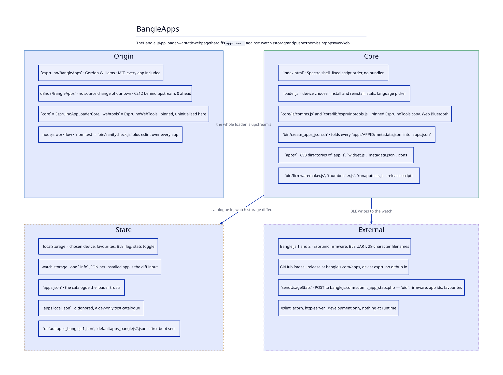

# BangleApps

The Bangle.js App Loader: a static web page that reads a catalogue of apps and pushes whichever ones are missing onto a Bangle.js watch over Web Bluetooth.

Read it left to right:

- **This fork holds no code of ours.** `d3nd3/BangleApps` is a plain mirror — 0 commits ahead of `espruino/BangleApps`, 6212 behind `upstream/master`. Everything on this page is upstream design, and the only local addition is this document.
- **The page cannot run from this clone yet.** `index.html` loads `core/lib/espruinotools.js`, `core/js/comms.js`, `core/js/ui.js` and `webtools/puck.js`, but `core` (EspruinoAppLoaderCore) and `webtools` (EspruinoWebTools) are submodules and both are uninitialised here. Those four files do not exist on disk, so the App Loader is only testable after `git submodule update --init --recursive`.
- **`apps.json` is generated, and it is the only catalogue the page trusts.** `bin/create_apps_json.sh` folds every `apps/<id>/metadata.json` into one JSON file, and the loader diffs that list against the `.info` files it can see in the watch's storage. An app that is listed but has no matching `.info` is uploaded; nothing is versioned beyond what the metadata says.
- **Apps are data on a 28-character filesystem, not a package format.** Each `apps/<id>` directory holds `app.js`, `widget.js`, images and an `interface.html`; the watch stores them under the same names, and renaming a file orphans the old copy instead of replacing it.
- **One thing leaves the browser unasked: usage stats.** `sendUsageStats` POSTs `uid`, firmware version, installed app ids and your favourites to `banglejs.com/submit_app_stats.php` after every refresh, gated only on the settings toggle and on the payload having changed. The release page at banglejs.com/apps is refreshed manually while espruino.github.io tracks every commit, so the two can serve different catalogues.

Diagram source: [`docs/system.d2`](docs/system.d2) · renderer: [`scripts/render-diagram.sh`](scripts/render-diagram.sh).
